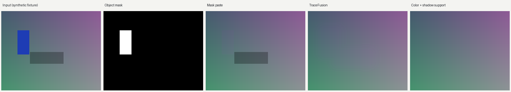

# Shadow Fusion

可选择模式、可独立消融模块的图片回贴工具。输入**原图、已生成的消除候选、原物体 mask**，自动估计额外编辑区域，并输出无损 PNG、alpha、编辑范围与运行配置。

这是研究原型。**只保证预测编辑范围之外的像素不变；误检进范围的真实背景仍可能被修改。** 当前不能作为“自动识别全部影子且背景绝对不变”的成熟方案。

## 安装与快速运行

```bash
python -m pip install -e .
shadow-fusion compose \
  --source examples/source.png --generated examples/generated.png \
  --mask examples/mask.png --output outputs/demo.png \
  --mode shadow --artifacts-dir outputs/demo_maps
```

也可以用 `python -m shadow_fusion`。冻结模式和纯残差探索策略无需 GPU、模型权重或 API 密钥；工具本身不生成消除候选。示例是**已知背景＋合成投影＋人为注入色偏的机制夹具**，不是消除模型输出。



## 模式与模块消融

| 模式 | 用途 | 默认校色 | 默认额外区域检测 | 默认 gamma | 默认羽化 |
|---|---|---|---|---|---|
| `mask` | 原 mask 直接回贴 | 关 | 关 | 关 | `none` |
| `tracefusion` | LensErase 论文 TraceFusion 的本地复现 | 关 | 开 | 开 | `paper` |
| `shadow` | 校色＋影子感应原型 | 开 | 开 | 关 | `single` |

```bash
# 原论文式回贴；不是官方实现
shadow-fusion compose --source input.png --generated edited.png --mask mask.png \
  --output outputs/tf.png --mode tracefusion

# 单独启用 gamma 暗部补充；最终回贴仍使用正常颜色图
shadow-fusion compose --source input.png --generated edited.png --mask mask.png \
  --output outputs/gamma.png --mode shadow --gamma on

# 多级羽化
shadow-fusion compose --source input.png --generated edited.png --mask mask.png \
  --output outputs/multilevel.png --mode shadow --feather multilevel

# 多模块消融
shadow-fusion compose --source input.png --generated edited.png --mask mask.png \
  --output outputs/ablated.png --mode shadow --ablate color,gamma,extra,feather

# 等价的独立开关
shadow-fusion compose --source input.png --generated edited.png --mask mask.png \
  --output outputs/custom.png --mode shadow --color off --extra on --gamma off --feather none
```

`--color`、`--extra`、`--gamma` 接受 `on/off`；`--feather` 接受 `none/single/multilevel/paper`。

配置优先级：**模式预设 → 配置 JSON → 显式参数 → `--ablate`**。禁用 `extra` 会同时禁用其 gamma 补充分支。禁用 `color` 只移除额外的 RGB 仿射校色，不移除原 TraceFusion 检测器内部的背景中位残差补偿。

```bash
shadow-fusion compose --source input.png --generated edited.png --mask mask.png \
  --output outputs/configured.png --config configs/shadow_gamma.json --ablate color
```

输出旁的 JSON 记录**最终生效配置**、输入哈希、CPU 耗时、编辑范围比例及范围外像素检查；`maps.npz` 保存全精度 alpha。多级羽化的单张 alpha 图表示低频分支，并不代表所有频带。

## 批量评估

JSONL 每行一个样本，路径相对于清单文件。影子标注与参考图只用于评估，**不传入回贴推理**：

```json
{"id":"case01","scene_id":"scene01","split":"dev","source":"images/source.png","generated":"images/edited.png","mask":"masks/object.png","shadow_mask":"labels/shadow.png","reference":"references/shadow_free.png"}
```

`shadow_mask`、`reference` 可省略。影子标注必须与物体 mask 不相交。

```bash
shadow-fusion batch --manifest examples/manifest.jsonl --output-dir outputs/baseline --mode shadow
shadow-fusion batch --manifest examples/manifest.jsonl --output-dir outputs/gamma --mode shadow --gamma on
python scripts/compact_runs.py --manifest examples/manifest.jsonl \
  --runs outputs/baseline outputs/gamma --output-dir outputs/compare
```

每个运行目录包含逐图输出、有效配置、全精度图、逐图／宏平均指标和每页最多十图的 compact。检测指标包括 precision、recall、F1、IoU；另外统计真实标注背景改动率、范围外最大差值及影子参考 RGB 误差。**范围外像素不变不能替代真实背景保护指标。** 比较多轮策略时必须固定清单、候选、分割与评价口径。

## 探索分支的可选策略

100 图探索记录见 [本轮记录](docs/CAMPAIGN_20261021.md)。`--research-config` 接入稳健 sRGB／平面校色、物体邻接、正向亮度置信度和羽化消融；只适用于 `shadow` 模式，与 `--config` 互斥。本轮已完成百图代理的锁定测试，选定配置见 `configs/selected.json`。全图去影代理测试 F1=0.71797、背景误改 0.6393%；真实已知五图仍误改 13.85%，前期保守单级配置约 7.86%。代理选型不能当作真实模型统一最优方案。

```bash
shadow-fusion compose --source input.png --generated edited.png --mask mask.png \
  --output outputs/research.png --mode shadow --research-config configs/research_plane_gate.json \
  --artifacts-dir outputs/research_maps

shadow-fusion compose --source input.png --generated edited.png --mask mask.png \
  --output outputs/no_confidence.png --research-config configs/research_plane_gate.json \
  --ablate confidence

shadow-fusion batch --manifest examples/manifest.jsonl --output-dir outputs/research_batch \
  --research-config configs/research_plane_gate.json --ablate color,gamma
```

探索参数顺序为类默认值 → 策略 JSON → 显式模块参数 → 消融。`color/extra/gamma/feather` 保留独立开关，另可 `--ablate association,confidence`。探索羽化可选 `adaptive/inward/inward_multilevel`；域内羽化会漏掉狭窄投影，目前仅用于消融。开启置信度时，支持域内的 alpha 可低于 1，物体 mask 内仍完整使用校色候选。结果 JSON 的 `research_config` 可直接提取为下一次运行的策略配置；`config` 记录引擎和有效开关。

可选 `ownership` 使用原图上的 CPU YOLOX 物体候选，为其他投影设置竞争种子。它不读取数据集其他物体标注，可能漏检非 COCO 物体。需要额外安装与显式下载，推理期间不自动联网；权重和官方包装代码均校验固定哈希，许可证保留在下载目录。

```bash
python -m pip install -e '.[research]'
python scripts/fetch_cpu_detector.py
```

随后在探索 JSON 中指定 `ownership: "euclidean"` 或 `"geodesic"`，可用 `--ablate ownership` 关闭。模型输出只在对应物体附近存在强变亮证据时参与竞争；没有竞争种子时保留原关联策略。CPU 检测耗时与缓存状态记录在 JSON 中，该模块在本轮未胜过纯残差策略，默认关闭。

## 已有实验与限制

冻结的 10 图实验包括 5 张可控夹具与 5 张真实照片，测试了原 mask、原 TraceFusion、校色有限羽化、校色多级羽化，以及后两者的 gamma 开关。

| 真实五图、有限羽化 | gamma 关 | gamma 开 |
|---|---:|---:|
| 影子 RGB 误差 ↓ | 17.42448 | 17.42408 |
| 影子 alpha 覆盖漏检率 ↓ | 0% | 0% |
| 远处背景改动率 ↓ | 51.17% | 52.20% |
| CPU 回贴耗时（ms）↓ | 95.6 | 118.1 |

这组数据不支持默认打开 gamma；原主检测已经覆盖标注影子，新增暗部支持主要落在无关背景。真实背景误检与非目标对象变色尚未解决。可控条件下的优秀校色结果不能外推成真实场景准确率。完整数字与范围定义见 [实验记录](docs/EXPERIMENTS.md)。

原始研究素材、生成候选和完整本地对照图不随代码仓库重发；仓库保留数值记录与冻结结果校验，输入由调用者提供。这里只发布图片回贴流程，不包含视频时序融合或消除模型。

## 测试与后续研究

```bash
python -m unittest discover -s tests -v
# 有本地冻结数据时，再核验六种配置 × 十图
python scripts/verify_frozen_baseline.py --legacy-root /path/to/image_shadow_tracefusion
```

当前打包版本已与既有 60 张输出逐像素校验。测试环境与原始回归记录见 `requirements-tested.txt` 和 `docs/results/packaged_regression.json`。跨依赖版本的浮点拟合可能导致舍入差异；严格复现应使用相同依赖。

后续 100 图探索在独立分支进行，保留 `main` 和基线标签。参见 [研究协议](docs/RESEARCH_PLAN.md)、[模块说明](docs/MODULES.md) 与 [来源说明](THIRD_PARTY_NOTICES.md)。

本项目为独立实现，不是 LensErase 官方代码，也未复现其完整消除模型。


## 背景保护优先的后续探索

见 [本轮记录](docs/BACKGROUND_FIRST_20261021.md)。`configs/background_first_candidate.json` 采用相对亮度置信、6→12绝对门控和两像素窄羽化，倾向少改背景；它会增加漏影，未通过预定验证召回线。`configs/background_first_selected.json` 保留保守回退。

已知真实五图的背景误改由保守7.86%降至候选3.25%，投影召回99.23%→96.68%，RGB误差16.505→17.021。新增20图片片全图代理背景误改1.301%→1.178%，召回86.51%→83.64%；仅目标代理候选召回76.47%。因此不替换冻结预设，不宣称背景完全不变。

```bash
shadow-fusion compose --source input.png --generated edited.png --mask mask.png --output outputs/background_first.png --research-config configs/background_first_candidate.json
shadow-fusion compose --source input.png --generated edited.png --mask mask.png --output outputs/no_relative_gate.png --research-config configs/background_first_candidate.json --ablate confidence
```

新增 `guard`、`transfer` 均可消融；严格光度守卫与纯亮度迁移在本轮失败，保留为复现入口，默认关闭。


源图复核发现新测试d009与已知跑步例来自同一赛事的不同照片，自动去重未排除事件关联；冻结20图主结果保留，另提供去掉d009的19图事后敏感性统计。其他事件身份缺少元数据，不能宣称20个独立新场景。详见 `docs/results/background_first_20261021/event_sensitivity19.json`。未替换样本或按此继续调参。
